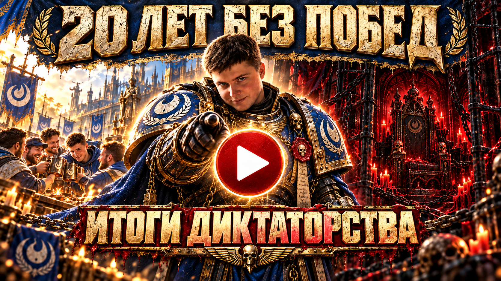

<h1 align="center">🏆 Grand Masters' of Game Cup #5</h1>

  <b>18 лет гильдии · 4 команды · 1 кубок</b>

  

  <a href="https://www.youtube.com/watch?v=dGuWKtrsGaA"><b>▶ Смотреть тизер турнира</b></a>

---

## 🧭 Даты проведения

Изначально ориентировались на 23 - 25 октября, но первичный скрининг показал, что турнир может несколько растянуться, рассчитываем на понимание 🥀

## 🎉 Приглашаем на турнир

Наша гильдия отмечает юбилей — **18 лет мы кошмарим врагов по всем фронтам!** Хотим разделить этот праздник с прекрасной половиной нашей прекрасной игры и приглашаем вас на **Grand Masters' of Game Cup #5**.

Возглавьте команду, зовите друзей и поборитесь за кубок!

| О турнире | Главное |
| :--- | :--- |
| Повод | 18-летие гильдии |
| Формат | Captains Draft |
| Участники | 4 команды и 4 капитана |
| Допуск | По приглашению капитана или гильдии |

## 📜 Мандат капитана

Четырём потенциальным капитанам направлено по мандату. Получив мандат, капитан:

1. Выбирает команду, в которой уже есть приглашённые участники.
2. Возглавляет её.
3. Добирает игроков под себя.

###  ⚖️ Баланс составов

Для баланса мы можем попросить капитана:

- Поставить игрока с высоким MMR на неосновную роль.
- Отдать игрока в драфт.

Мы и сами готовы менять роли и команды: универсальные солдаты, флексим буквально на всех позициях.

> [!IMPORTANT]
> Участвовать в турнире могут только игроки, приглашённые капитаном или напрямую гильдией.

## ⚔️ Рыцарский момент

| | Условие |
| :---: | :--- |
| 💰 | В распределении призового фонда участвуют **только девушки**. |
| 🏆 | В голосовании за лучшего игрока турнира участвуют **только девушки**. |

## 🎯 Формат турнира — Captains Draft

Все матчи - BO3, каждая победа на карте приносит одно очко в Группе.

Ниже — предварительные составы из участников гильдии. Капитаны могу выбрать любой из доступных составов, доукомплектовать его на своё усмотрение из своих друзей и знакомых. Дальше будет небольшая драфт-стадия, в полной коммуникации с капитанами

### 💖 TEAM A

| Позиция | Роль | Игрок | MMR | |
| :---: | :--- | :--- | ---: | ---: |
| 1 · ⚔️ | Керри | — | — | 👸 |
| 2 · 🏹 | Мидер | — | — | 👸 |
| 3 · 🛡️ | Офлейнер | [Gri$H@doW](https://www.dotabuff.com/players/45710020) | 1 800 | 🤴 |
| 4 · 🔥 | Саппорт | [EvGenx](https://www.dotabuff.com/players/62877738) | 5 000 | 🤴 |
| 5 · ❤️‍🩹 | Полная поддержка | — | — | 👸 |

### 🧚‍♀️ TEAM B

| Позиция | Роль | Игрок | MMR | |
| :---: | :--- | :--- | ---: | ---: |
| 1 · ⚔️ | Керри | [roolix](https://www.dotabuff.com/players/160504018) | 3 000 | 🤴 |
| 2 · 🏹 | Мидер | — | — | 👸 |
| 3 · 🛡️ | Офлейнер | — | — | 👸 |
| 4 · 🔥 | Саппорт | — | — | 👸 |
| 5 · ❤️‍🩹 | Полная поддержка | [BrackeT](https://www.dotabuff.com/players/81117431) | 2 000 | 🤴 |

### 👰‍♀️ TEAM C

| Позиция | Роль | Игрок | MMR | |
| :---: | :--- | :--- | ---: | ---: |
| 1 · ⚔️ | Керри |  | | 👸 |
| 2 · 🏹 | Мидер | [lil bubi](https://www.dotabuff.com/players/109694355) | 2 000 | 🤴 |
| 3 · 🛡️ | Офлейнер | [Zaccone](https://www.dotabuff.com/players/57346674) | 3 000 | 🤴 |
| 4 · 🔥 | Саппорт | kriamant | 5000 | 👸 |
| 5 · ❤️‍🩹 | Полная поддержка | — | — | 👸 |

### 👸 TEAM D

| Позиция | Роль | Игрок | MMR | |
| :---: | :--- | :--- | ---: | ---: |
| 1 · ⚔️ | Керри | — | — | 👸 |
| 2 · 🏹 | Мидер | [flenronn](https://www.dotabuff.com/players/79804794) | 5 000 |🤴| 
| 3 · 🛡️ | Офлейнер | — | — | 👸 |
| 4 · 🔥 | Саппорт | — | — | 👸 |
| 5 · ❤️‍🩹 | Полная поддержка | — | — | 👸 |

*«—» — место пока не заполнено.*

---

## 🟢 Обновления турнира

- ✅ **w1spulya** приняла мандат.
- ✅ **xxkoi__** предварительно приняла мандат.
- ⏳ **leviamur** раздумывает над принятием мандата.
